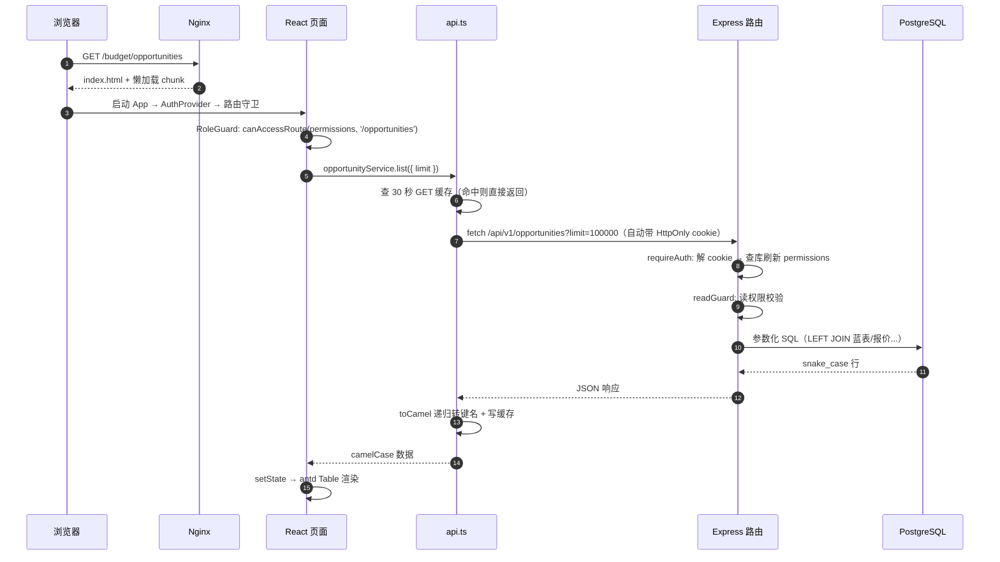

# 04 核心架构与端到端数据流

> **本章学习目标**
> 1. 完整走一遍"一次页面加载"的每一层；
> 2. 精读 Budget 的 `utils/api.ts`（全项目最核心的基础设施）；
> 3. 理解前端三层、后端四层各自的边界；
> 4. 掌握 camelCase/snake_case 命名边界与 GET 缓存机制。

---

## 4.1 一次页面加载的完整旅程

以「销售机会列表」（`/budget/opportunities`）为例，从浏览器到数据库再到浏览器：

```
① 浏览器请求 /budget/opportunities
   → nginx 命中 SPA，返回 index.html（+ 预加载脚本）

② React 启动（main.tsx → App.tsx）
   → AuthProvider 挂载，useEffect 调 /auth/me 验证会话
   → 路由匹配 /opportunities → RoleGuard 用 canAccessRoute(user.permissions, '/opportunities') 校验
     权限不足 → 重定向到 firstAccessiblePath（首个可访问路由）

③ Suspense 懒加载 SalesOpportunityList.tsx（Vite 独立 chunk）
   → 页面 useEffect 里调用 opportunityService.list({ limit: LIST_LIMIT })

④ opportunityService.list
   → api.get<SalesOpportunity[]>('/opportunities?limit=100000')

⑤ api.ts：
   → 查 30 秒 GET 缓存，命中直接返回
   → 未命中 → fetch('/api/v1/opportunities?limit=100000')
     （同源请求，浏览器自动携带 HttpOnly cookie）

⑥ 后端：
   → Express 中间件链：cors → helmet → json 解析
   → 路由挂载（routes/index.ts）：requireAuth
       · 从 cookie 取 token（budget_token/tr_token）
       · 验签 → 查库刷新 permissions/role/title/display_name
       · 停用判定 / 改密吊销判定
   → 守卫：readGuard(READ_GUARD.opportunities)
       · GET 请求须有（销售机会管理 / 编辑销售机会 / 报价编制 / 仪表盘查看 / 销售分析 / 全部查看权限）之一
   → routes/opportunities.ts 自定义 GET /
       · 参数化 SQL：SELECT so.*, 蓝表 JSONB, has_quote, 关联报价 ... LEFT JOIN ... ORDER BY sales_no
       · parsePagination 处理 limit/offset
   → 返回 snake_case JSON 数组

⑦ api.ts 收到响应：
   → toCamel() 把每个对象的键递归转成 camelCase
   → 写入 30 秒缓存
   → 返回给页面

⑧ 页面 setState(rows) → antd <Table> 渲染
   → 用户看到机会列表（蓝表赢率、阶段色标、报价状态图标）
```

同样的旅程画成时序图：



**这条链路上的三个关键理解**：

1. **后端只认 cookie 不认 Authorization header**：登录时后端 `Set-Cookie`，浏览器自动带，前端 JS 全程接触不到 token。见 06 章。
2. **snake_case 在 "后端 → api.ts" 这一段转换**：api.ts 是唯一转换点。后端返回的键是 `client_name`，到页面就变成 `clientName`。
3. **权限有两道闸**：前端 RoleGuard（UX）+ 后端 readGuard（安全）。前端那道能跳过去（直接输 URL），但后端那道会 403。

## 4.2 前端三层：页面 / 服务 / API 客户端

```
pages/*          —— 状态 + 渲染 + 交互，不做 fetch
     │  只调 service
services/*       —— 每个资源一个对象，方法签名 = 接口路径 + 类型参数
     │  只调 api
utils/api.ts     —— 唯一 fetch 封装：缓存 / 键名转换 / 错误 / 401
```

三层各司其职，**禁止越层**：
- 页面里绝不直接写 `fetch`；
- service 里不做业务计算，只是"声明要调哪个接口、返回什么类型"；
- api.ts 不做业务判断，只做"通用传输协议"。

**service 示例**（`services/opportunityService.ts`）：

```ts
import { api } from '../utils/api';
import type { SalesOpportunity, BlueTable, BlueTableRole } from '../types';

export const opportunityService = {
  // 列表：拼 query 字符串
  list: (params?: Record<string, string>) =>
    api.get<SalesOpportunity[]>('/opportunities' + (params ? '?' + new URLSearchParams(params).toString() : '')),
  // 单条
  get: (id: string) =>
    api.get<SalesOpportunity>(`/opportunities/${id}`),
  // 创建/更新：body 会被 api.ts 自动 toSnake
  create: (data: Partial<SalesOpportunity>) =>
    api.post<SalesOpportunity>('/opportunities', data),
  update: (id: string, data: Partial<SalesOpportunity>) =>
    api.put<SalesOpportunity>(`/opportunities/${id}`, data),
  // 蓝表保存（包含 roles）
  saveBlueTable: (id: string, data: BlueTable) =>
    api.put<BlueTable & { roles: BlueTableRole[] }>(`/opportunities/${id}/blue-table`, data),
};
```

> 💡 你能发现：service 几乎是机械的——所以项目里宁可多写几个方法也不搞过度抽象。它的价值是**让页面代码干净**，并给"这个资源有哪些接口"提供一个目录。

## 4.3 精读 `utils/api.ts`（全项目最重要的一段前端代码）

### 4.3.1 缓存层

```ts
const API_BASE = import.meta.env.VITE_API_BASE || '/api/v1';

// ── GET 请求缓存（30 秒 TTL，避免页面切换重复请求） ──
const cache = new Map<string, { data: unknown; expiry: number }>();
const CACHE_TTL = 30_000;

function getCached(key: string): unknown | undefined {
  const entry = cache.get(key);
  if (entry && entry.expiry > Date.now()) return entry.data;  // 未过期 → 命中
  cache.delete(key);                                           // 已过期 → 清掉
  return undefined;
}

function setCache(key: string, data: unknown) {
  cache.set(key, { data, expiry: Date.now() + CACHE_TTL });
  if (cache.size > 100) {                                      // 防内存无限涨：超 100 条丢最早一条
    const firstKey = cache.keys().next().value;
    if (firstKey) cache.delete(firstKey);
  }
}
```

要点：
- **缓存键 = 完整路径（含 query）**：service 把 query 拼进 path（如 `/opportunities?limit=100000`），`cacheKey = path` 因此不同 query 是不同缓存键、**互不覆盖**。
- 30 秒 TTL：用户来回切页面不重复请求，但数据不会陈旧太久。
- 上限 100 条：防内存泄漏。

### 4.3.2 键名转换（toCamel / toSnake）

```ts
export function toCamel(obj: unknown): unknown {
  if (obj === null || obj === undefined) return obj;
  if (typeof obj !== 'object') return obj;
  if (obj instanceof Date) return obj;              // Date 不碰
  if (Array.isArray(obj)) return obj.map((item) => toCamel(item));
  const record = obj as Record<string, unknown>;
  const result: Record<string, unknown> = {};
  for (const key of Object.keys(record)) {
    // ⚠️ 下划线开头的键（如 _risk, _commercial）为内部标识符，不做转换
    result[key.startsWith('_') ? key : key.replace(/_([a-z])/g, (_, l) => l.toUpperCase())] = toCamel(record[key]);
  }
  return result;
}

export function toSnake(obj: unknown): unknown {
  // ... 对称实现：camelCase → snake_case
  result[key.replace(/[A-Z]/g, l => '_' + l.toLowerCase())] = toSnake(record[key]);
}
```

要点：
- **递归**：深层嵌套对象/数组全部转换。
- **`_` 开头的键保留**：`_risk`、`_commercial` 这类是前端的内部标记，转换层不认识，跳过。
- 转换是"键名"转换，**值不变**。所以 `{ clientName: 'A公司' }` → `{ client_name: 'A公司' }`。

### 4.3.3 request() 主函数

```ts
export class ApiError extends Error {
  status: number;
  constructor(status: number, message: string) { super(message); this.status = status; this.name = 'ApiError'; }
}

async function request<T>(path: string, options?: RequestInit, noCache?: boolean): Promise<T> {
  const url = `${API_BASE}${path}`;
  const isGet = !options || options.method === undefined || options.method === 'GET';

  // GET 优先走缓存（noCache 时跳过）
  if (isGet && !noCache) {
    const cached = getCached(path);
    if (cached !== undefined) return cached as T;
  }

  // token 在 HttpOnly cookie，fetch 同源自动携带，无需 Authorization header
  const headers: Record<string, string> = { 'Content-Type': 'application/json' };

  let res: Response;
  try {
    res = await fetch(url, { method: options?.method, body: options?.body, headers: { ...headers, ...(options?.headers || {}) } });
  } catch (err) {
    throw new ApiError(0, '网络请求失败：' + (err instanceof Error ? err.message : '未知错误'));
  }

  // 401 = cookie 无效/过期 —— best-effort 清服务端 cookie 再跳登录
  if (res.status === 401) {
    fetch(API_BASE + '/auth/logout', { method: 'POST' }).catch(() => {});
    window.location.href = import.meta.env.BASE_URL + 'login';
    throw new ApiError(401, '登录已过期，请重新登录');
  }

  if (!res.ok) {
    const body = await res.json().catch(() => ({ error: res.statusText }));
    throw new ApiError(res.status, body.error || `Request failed (${res.status})`);
  }

  if (res.status === 204) return undefined as T;   // 204 无内容

  const data = await res.json();
  const result = toCamel(data) as T;

  // GET 写缓存；非 GET 清相关前缀缓存
  if (isGet) {
    if (!noCache) setCache(path, result);
  } else {
    const resourcePrefix = path.split('?')[0].split('/')[1] || '';
    if (resourcePrefix) clearCache('/' + resourcePrefix);
    for (const p of getCascadePrefixes(path)) clearCache(p);   // 跨资源级联清
  }
  return result;
}
```

**逐块讲解**：

1. **401 处理**是唯一"危险"的地方：它直接 `window.location.href` 跳登录。为什么？因为 token 在 HttpOnly cookie 里，前端**读不到也清不掉**，只能调 logout 让服务端清。这是"前端拿不到 token"这种安全设计的必然代价。
2. **`!res.ok` 分支**：后端错误响应统一 `{ error: '消息' }`，这里解析后抛 `ApiError(status, message)`。页面 catch 后 `message.error(e.message)` 就能显示后端给的中文错误。
3. **缓存写入策略**：
   - GET → 写缓存；
   - 非 GET → 清该资源前缀的缓存（`/opportunities`），并且用 `getCascadePrefixes` **级联清相关资源**（例如审批被处理后，报价/项目/交付/机会都可能变，全清）。

### 4.3.4 级联清缓存（getCascadePrefixes）

```ts
export function getCascadePrefixes(path: string): string[] {
  if (path.startsWith('/project-versions') || path.startsWith('/project-groups')) return ['/projects'];
  if (path.startsWith('/approvals')) return ['/quotations', '/projects', '/deliveries', '/opportunities'];
  return [];
}
```

这是一个**纯函数**（无副作用），所以它能被单测直接锁住契约——`tests/api.test.ts` 里就有。为什么把"级联规则"抽出来而不是写死？因为它是"写接口 → 哪些列表会变"的知识，独立成函数后：
- 可测；
- 改规则只改一处；
- 防止"30 秒内读到陈旧数据"的 bug 复发（`startsWith('/approvals')` 同时覆盖创建与审批记录，这是 BU-4 修复的教训）。

### 4.3.5 对外 API

```ts
export const api = {
  get:    <T>(path: string, opts?: { noCache?: boolean }) => request<T>(path, undefined, opts?.noCache),
  post:   <T>(path: string, body: unknown) => request<T>(path, { method: 'POST', body: JSON.stringify(toSnake(body)) }),
  put:    <T>(path: string, body: unknown) => request<T>(path, { method: 'PUT',  body: JSON.stringify(toSnake(body)) }),
  delete: <T>(path: string) => request<T>(path, { method: 'DELETE' }),
};
```

注意 **POST/PUT 的 body 在这里 `toSnake`**。所以页面里写 `{ clientName: 'A' }` 即可，后端收到的是 `{ client_name: 'A' }`。这是全项目命名边界的落地点。

## 4.4 后端四层

```
① 路由表 routes/index.ts      —— 挂载顺序 + 守卫接线（读改写分离）
② 业务路由 routes/*.ts        —— 端点定义 + 业务规则 + 状态机
③ 共享工具 routes/helpers.ts  —— crudRoutes 工厂 / 事务 / 审计 / 分页
④ 数据访问 db/pool.ts         —— 参数化 SQL + 类型解析器
```

### 4.4.1 读改写分离（routes/index.ts 的模式）

```ts
const writeGuard = (perms: string[]) => (req, res, next) => {
  if (req.method !== 'GET') return requirePermission(...perms)(req, res, next);
  next();
};
const readGuard = (perms: string[]) => (req, res, next) => {
  if (req.method === 'GET') return requirePermission(...perms)(req, res, next);
  next();
};
```

- **写接口**（POST/PUT/DELETE）过 `writeGuard`——要求写动作权限；
- **读接口**（GET）过 `readGuard`——要求读权限（敏感数据不对零权限用户开放，这是 H1 审计修复）；
- 权限集合收敛在 `permissions.ts`，**禁止在挂载处内联权限数组**（有静态断言测试盯着）。

### 4.4.2 参数化 SQL（防注入的铁律）

后端**所有** SQL 都用 `$1, $2...` 参数占位，值通过 params 数组传入。绝不用字符串拼接：

```ts
// ✅ 正确：参数化
await query('SELECT * FROM components WHERE code = $1', [code]);

// ❌ 禁止：字符串拼接
await query(`SELECT * FROM components WHERE code = '${code}'`);
```

`pg` 驱动会转义参数，杜绝 SQL 注入。这是全后端的第一条硬规矩。

### 4.4.3 类型解析器（db/pool.ts）

```ts
pg.types.setTypeParser(1700, (val: string) => parseFloat(val));  // NUMERIC → number
pg.types.setTypeParser(1082, (val: string) => val);              // date → 原样字符串
```

- PostgreSQL 的 `NUMERIC` 默认返回**字符串**（为了精度），这里注册解析器转成 number——否则前端拿到的 `amount` 是 `"1500.00"` 字符串，算术会出错。
- `date` 类型默认会被 node-postgres 转成 JS Date，序列化时变成 UTC ISO 串，在中国时区会**差一天**。本项目唯一 date 列是工时的 `time_records.date`，前端一律按字符串用，所以这里直接原样返回 `YYYY-MM-DD`。**这是时区事故（F05）的经典修复**。

## 4.5 TR 的 api.js 与 Budget api.ts 的对比（理解两种取舍）

| 维度 | Budget `api.ts` | TR `api.js` |
|---|---|---|
| 键名转换 | 自动 toSnake/toCamel | **无**——TR 直接用 snake_case 字段 |
| GET 缓存 | 30s TTL | **无** |
| 401 处理 | 直接 `window.location.href` 跳登录 | 派发 `SESSION_EXPIRED_EVENT`，AuthContext 监听后统一登出（更解耦） |
| 超时 | 无 | 20s AbortController |
| 类型 | TS 泛型 | JS 无类型 |
| 截断防护 | 调用方显式传 limit | 调用方传 limit + `checkTruncation` 告警 |

**为什么 TR 不用转换？** 因为 TR 的页面直接使用后端字段（`cost_center`、`start_time`），没有 TS 类型层，转换反而多一层复杂度。**为什么 Budget 用转换？** 因为有 TS 类型（camelCase 友好）且要处理多级嵌套对象（报价组/明细），转换层价值大。

> 学习建议：先精读 Budget 的 api.ts（更工程化），再看 TR 的 api.js 体会"简化到极致"的版本。

## 4.6 本章小结

- 端到端链路：nginx → React 路由守卫 → 懒加载页面 → service → api.ts（缓存/转换）→ Express 鉴权/守卫 → 参数化 SQL → 数据库 → 原路返回 → toCamel → 渲染。
- api.ts 是三件事：30s GET 缓存、camel/snake 转换、统一错误与 401。
- 后端四层：路由装配（读改写分离）/ 业务路由 / 共享 helpers / 数据访问。
- 铁律：参数化 SQL、不内联权限数组、服务端权威。

**本章练习**：打开 `tests/api.test.ts`，看 `getCascadePrefixes` 和 toSnake 的测试是怎么写的；然后在浏览器 DevTools 的 Network 面板里，把 Budget 任意列表页刷新两次，观察第二次是否命中缓存（第二次不再发请求，或很短）。

> 下一章：[05 领域模型与数据库](05-领域模型与数据库.md) →
