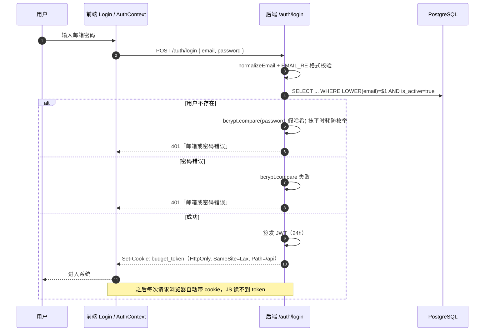

# 06 认证与权限体系

> **本章学习目标**
> 1. 吃透 HttpOnly Cookie + JWT 的认证模型，逐行读懂 `middleware/auth.ts`；
> 2. 理解"双应用 token 互通"与"跨应用登录限制"；
> 3. 完整掌握前后端双守卫的权限模型（前端 UX + 后端权威）；
> 4. 读懂越级保护与权限委托限制（防止提权链）。

---

## 6.1 认证模型总览

```
登录成功
   │  bcrypt.compare 校验密码
   ▼
后端签发 JWT（含 userId/email/role，24h 有效）
   │
   ▼
Set-Cookie: budget_token=...; HttpOnly; SameSite=Lax; Path=/api; Max-Age=86400
   │  （或 tr_token —— 两应用共用同一 JWT_SECRET 与 users 表）
   ▼
前端 JS 永远读不到 token（HttpOnly）→ 防 XSS 窃取
浏览器请求时自动携带 cookie（同源）→ 防 CSRF（SameSite=Lax + 无 CORS 跨域）
   │
   ▼
每次请求：requireAuth 解 token → 查库刷新 role/permissions → 停用/改密吊销判定
```

**为什么不用 localStorage 存 token？** 因为任何 XSS 注入的脚本都能 `localStorage.getItem('token')` 拿到它。HttpOnly cookie 让脚本 `document.cookie` 也读不到。这是 2026-07 从"Bearer header 方案"迁移到"HttpOnly cookie 方案"的原因（代码注释标注为 L6 修复）。

登录成功与后续请求的时序：



> **后续请求的安全闭环**：cookie 由浏览器自动携带（同源）→ `requireAuth` 解出 JWT → **每次查库刷新** permissions/role → 停用/改密吊销判定 → 才进入业务路由。前端从头到尾接触不到 token，这就是 HttpOnly cookie 方案的完整链路。

## 6.2 逐行读 `middleware/auth.ts`

### 6.2.1 cookie 手写解析（不引第三方库）

```ts
export const COOKIE_NAME_TR = 'tr_token';
export const COOKIE_NAME_BUDGET = 'budget_token';
const COOKIE_MAX_AGE_MS = 24 * 60 * 60 * 1000;   // 对齐 JWT exp（24h）
const COOKIE_SECURE = process.env.COOKIE_SECURE === '1';  // 生产 HTTPS 后设 1，否则 0

/** 手写 cookie 解析（不引入 cookie-parser 依赖）：取指定 name 的值，无则 undefined */
function cookieValue(header: string | undefined, name: string): string | undefined {
  if (!header) return undefined;
  for (const part of header.split(';')) {
    const eq = part.indexOf('=');
    if (eq === -1) continue;
    if (part.slice(0, eq).trim() === name) return decodeURIComponent(part.slice(eq + 1).trim());
  }
  return undefined;
}
```

要点：
- 为一个字段名手写解析器，**刻意不引 cookie-parser**——依赖最小化；
- 解析逻辑很简单：按 `;` 切、按 `=` 切、匹配名字、`decodeURIComponent` 解码值。

### 6.2.2 写/清 cookie（Path 与 SameSite 是安全关键）

```ts
export function setAuthCookie(res, name, token): void {
  res.cookie(name, token, {
    httpOnly: true,
    sameSite: 'lax',
    secure: COOKIE_SECURE,
    path: '/api',          // ★ 只随 /api 请求发送，不随静态资源（防不必要的暴露）
    maxAge: COOKIE_MAX_AGE_MS,
  });
}

export function clearAuthCookie(res, name): void {
  res.clearCookie(name, { httpOnly: true, sameSite: 'lax', secure: COOKIE_SECURE, path: '/api' });
}
```

三个安全点的作用：
| 选项 | 防什么 |
|---|---|
| `httpOnly: true` | 防 XSS 脚本读 token |
| `sameSite: 'lax'` | 防跨站 CSRF（别的网站发起的请求不带这个 cookie） |
| `path: '/api'` | cookie 只随 API 请求发送，减少暴露面 |

⚠️ `clearCookie` 的选项必须与 `set` **完全一致**，否则清除无效（浏览器按 path/domain 匹配 cookie）。

### 6.2.3 requireAuth：每次请求都查库（关键设计）

```ts
export async function requireAuth(req, res, next): Promise<void> {
  const token = cookieValue(req.headers.cookie, COOKIE_NAME_TR) || cookieValue(req.headers.cookie, COOKIE_NAME_BUDGET);
  if (!token) { res.status(401).json({ error: '未登录，请先登录' }); return; }

  let decoded;
  try { decoded = jwt.verify(token, JWT_SECRET, { algorithms: ['HS256'] }); }
  catch { res.status(401).json({ error: '登录已过期，请重新登录' }); return; }

  try {
    const userRow = await pool.query(
      `SELECT u.is_active, u.permissions, u.role, u.title, u.display_name, u.password_changed_at,
              EXISTS(SELECT 1 FROM timerecording.profiles p WHERE p.id = u.id AND NOT p.is_active) AS tr_disabled
       FROM users u WHERE u.id = $1`, [decoded.userId]);
    const row = userRow.rows[0];
    // 停用判定：users.is_active=false，或存在且为 false 的工时档案
    if (!row?.is_active || row.tr_disabled) { res.status(401).json({ error: '账户已被停用' }); return; }

    // 改密吊销：token 签发时刻(iat)早于最近改密时间 → 失效
    if (row.password_changed_at) {
      const changedSec = Math.floor(new Date(row.password_changed_at).getTime() / 1000);
      if ((decoded.iat || 0) < changedSec) { res.status(401).json({ error: '密码已修改，请重新登录' }); return; }
    }

    req.user = { ...decoded, role: row.role, permissions: row.permissions || [], title: row.title, display_name: row.display_name };
    next();
  } catch { res.status(500).json({ error: '服务器内部错误' }); }
}
```

**为什么"每次请求都查库"而不直接用 JWT 里的 payload？** 因为 JWT 一旦签发，payload 就固定了。如果不查库：
- 管理员改了某用户权限 → 旧 token 里的旧权限要等 24h 过期才生效；
- 用户被停用 → 旧 token 依然有效；
- 用户改密 → 旧 token 依然有效。

查库刷新让**权限/停用/改密变更即时生效**。代价是每次请求多一条查询——对中小系统完全可接受（而且有 `users.id` 主键索引）。

**`iat` 与 `password_changed_at` 的秒级比较**：
- `iat` 是 JWT 签发的 Unix 秒；
- `password_changed_at` 是改密的 DB 时间，`Math.floor(毫秒/1000)` 取整到秒；
- 规则：`iat < 改密秒` → 旧 token 失效。同一秒内的新登录（改密后立即登录）不被误杀。

**双 cookie 认其一**：`COOKIE_NAME_TR || COOKIE_NAME_BUDGET`。因为两应用共用 JWT_SECRET，token 互通——你登录了 Budget 拿到 `budget_token`，去 TR 的 API 也认；反之亦然。各应用登录/登出只写/清自己的 cookie。

### 6.2.4 权限判定三件套

```ts
export function hasPermission(permissions, ...required): boolean {
  return !!permissions && required.some(p => permissions.includes(p));   // OR：任一命中即放行
}

export function requireRole(...roles: string[]) {
  return (req, res, next) => {
    if (!req.user || !roles.includes(req.user.role)) { res.status(403).json({ error: '权限不足' }); return; }
    next();
  };
}

export function requirePermission(...required: string[]) {
  return (req, res, next) => {
    if (!hasPermission(req.user?.permissions, ...required)) { res.status(403).json({ error: '权限不足' }); return; }
    next();
  };
}
```

⚠️ **`some()`（OR）语义**意味着：只要权限数组命中任意一个要求就放行。这是"功能只要满足其一权限"的设计。但也带来风险——如果写守卫的权限集里混入了"只读页面权限"，那么"只有查看权限"的用户也能写了。这正是 `permissions.ts` 里 `PAGE_VIEW_ONLY_PERMS` + `findPageViewLeaks` 要防的事（见下节）。

## 6.3 权限清单的单一来源：`permissions.ts`

### 6.3.1 写守卫（WRITE_GUARD）

```ts
export const WRITE_GUARD: Record<string, string[]> = {
  components: ['新增物料', PERM_ALL],
  projects:   ['报价编制', PERM_ALL],
  opportunities: ['编辑销售机会', '新建信息/线索/机会', '转线索/转机会', '销售蓝表编辑', PERM_ALL],
  quotations: ['报价编制', PERM_ALL],
  clients:    ['新建客户', PERM_ALL],
  tags:       ['新建标签', PERM_ALL],
  'project-versions': ['报价编制', PERM_ALL],
  'project-groups':   ['报价编制', PERM_ALL],
};
```

**A1 审计修复的关键点**：写守卫**只列"写动作权限"**，不列纯只读页面权限（物料管理/客户管理/销售机会管理/仪表盘查看/销售分析/交付分析/报价列表查看）。否则 `some()` 会让"仅持查看权限"的用户也能增删改。

### 6.3.2 读守卫（READ_GUARD）

```ts
export const READ_GUARD: Record<string, string[]> = {
  opportunities: ['销售机会管理', '编辑销售机会', '报价编制', '仪表盘查看', '销售分析', PERM_ALL],
  quotations:   ['报价列表查看', '报价编制', '交付管理', '销售机会管理', '仪表盘查看', '销售分析', '交付分析', '审批管理', PERM_ALL],
  ...
};
```

读守卫的权限集 = "该页面所需权限 ∪ 跨页读取方"。例如报价数据会被仪表盘、销售分析、交付分析读取，所以这些页面的权限都要列入——否则仪表盘读报价会被 403。

### 6.3.3 特殊拆分守卫（审批、交付）

```ts
export function selectApprovalPerms(approvalType: string | undefined): string[] {
  const perms = approvalType ? APPROVAL_WRITE[approvalType] : undefined;
  return perms || APPROVAL_WRITE_FALLBACK;
}
// APPROVAL_WRITE = { quotation:['报价编制'], plan:['交付管理'], cost:['交付管理','成本录入'], promote:['转线索/转机会'] }

export function selectDeliveryPerms(method: string, path: string): string[] {
  if (method === 'POST' || (method === 'PUT' && path.endsWith('/nodes'))) return DELIVERY_CREATE_WRITE;  // 转交付链路
  return DELIVERY_OTHER_WRITE;  // 其余写操作须交付管理
}
```

**为什么审批要按类型拆？** 如果审批写守卫用 blanket OR-set（一个数组包含所有模块权限），那么只持"报价编制"权限的人也能创建 plan/cost/promote 审批。拆开后：创建审批必须持有**对应业务模块**的写权限；处理审批（POST /:id/records）走"审批管理"兜底。

**为什么交付要按方法拆？** "销售机会管理"权限应该只能做"转交付创建/初始化节点"，不能改实际成本、不能删除交付。所以创建 + 节点保存放行，其余写操作要求"交付管理"。

## 6.4 越级保护（防提权链）

### 6.4.1 ROLE_RANK 与 assertCanManage

```ts
export const ROLE_RANK: Record<string, number> = { user: 0, manager: 1, director: 2, admin: 3 };

export function assertCanManage(actorRole: string, targetRank: number): void {
  const actorRank = ROLE_RANK[actorRole] ?? 0;    // 未知角色按最低等级（无越级能力）
  if (targetRank > actorRank) throw new AppError(403, '无权创建/修改更高权限的账号');
}
```

**场景**：director(2) 想创建 admin(3) 账号 → `targetRank=3 > actorRank=2` → 403。

⚠️ 曾经的 bug：把 director 也算作 super 导致 director 能管理 admin。修复：**纯 ROLE_RANK 等级比较**。

### 6.4.2 权限委托限制（validatePermissionsGrant）

```ts
export function validatePermissionsGrant(permissions, actorPerms): void {
  // ① 白名单校验：不在 ALL_PERMISSIONS 里的权限 → 400
  // ② 委托限制：只能授出操作者自己已持有的权限 → 否则 403
}
```

**场景**：管理员 A 只有"报价编制"，他想给用户 B 授"审批管理"——B 拿到后就能审批，而 A 自己都没有审批权限。这会造成**权限横向放大**。所以规则：**只能授出自己持有的权限**。

## 6.5 前端权限（UX 层，不是安全层）

### 6.5.1 路由 → 所需权限映射

```ts
// utils/permissions.ts
const ROUTE_REQUIRED_PERMS: Record<string, string[]> = {
  '/':                ['仪表盘查看'],
  '/analysis':        ['销售分析', '全部查看权限'],
  '/opportunities':   ['销售机会管理', '全部查看权限'],
  '/quotations':      ['报价列表查看', '报价编制', '全部查看权限'],
  '/delivery':        ['交付管理', '全部查看权限'],
  '/approval':        ['审批管理', '全部查看权限'],
  '/settings':        ['用户管理', '系统配置', '全部查看权限'],
  ...
};
```

### 6.5.2 canAccessRoute 与 B30 重定向死循环修复

```ts
export function canAccessRoute(permissions, path): boolean {
  if (!permissions || permissions.length === 0) return false;
  if (ROUTE_REQUIRED_PERMS[path]) return ROUTE_REQUIRED_PERMS[path].some(p => permissions.includes(p));
  const prefix = '/' + path.split('/')[1];          // 前缀匹配：/delivery/xxx → /delivery
  const required = ROUTE_REQUIRED_PERMS[prefix];
  if (required) return required.some(p => permissions.includes(p));
  return true;                                      // 未知路径默认放行
}
```

**B30 教训**：RoleGuard 对无权限路径原来统一重定向到 `/`，而 `/` 要求"仪表盘查看"——无该权限的用户陷入「guard 失败→重定向→再失败」的**无限循环**（React Maximum update depth exceeded）。修复：重定向到 `firstAccessiblePath(permissions)`（第一个可访问的路由），全无权限则显示"无可用模块"而不是继续重定向。

### 6.5.3 前端 vs 后端的定位

| 层 | 作用 | 能不能被绕过 | 结论 |
|---|---|---|---|
| 前端 RoleGuard/按钮门控 | 隐藏入口，改善体验 | 能（直接输 URL / 改请求） | 只是 UX |
| 后端 requirePermission | 真正拦截 | 不能 | 权威 |

所以写权限功能时：**前端隐藏按钮（体验）+ 后端拦截（安全），两处都要改**，缺一不可。而测试会锁定后端那套（`permissions.test.ts` 检查"只读权限不得混入写守卫"）。

## 6.6 跨应用登录限制（纵深防御）

```ts
// auth.ts
export function isRestrictedCrossAppUser(title: unknown, role: unknown): boolean {
  return title === '普通员工' && role !== 'admin' && role !== 'director';
}
```

**场景**：普通员工只能用工时应用（TR），不能登录销售·交付应用（Budget）。此函数在**登录端点**和 **/auth/me** 两处都判断——防止持有旧 token 的用户绕过。

**TR 侧再补一刀**（`trAppGuard`）：销售经理（title='销售经理' 且非 director/admin）禁止调用**任何**工时 API。为什么 TR 要单独拦？因为 token 互通，销售经理登录 Budget 后拿到 `budget_token`，可以**直接调 TR 的 API**（不需要登录 TR）。TR 在 requireAuth 之后再加这道 guard，形成纵深防御。

## 6.7 登录接口的安全细节（auth.ts）

```ts
const user = result.rows[0];
if (!user) {
  await bcrypt.compare(password, DUMMY_PASSWORD_HASH);  // 假比较：耗时与真实一致，防邮箱枚举
  throw new AppError(401, '邮箱或密码错误');
}
const valid = await bcrypt.compare(password, user.password_hash);
if (!valid) { throw new AppError(401, '邮箱或密码错误'); }
```

- **统一文案**："邮箱或密码错误"（用户不存在 / 密码错 都返回同样的话）→ 防通过报错区分注册邮箱；
- **假 bcrypt 比较**：用户不存在时也做一次 compare，**耗时与真实比较一致** → 防通过响应时间探测邮箱是否注册；
- **邮箱归一化**：`normalizeEmail`（trim + 小写）+ `EMAIL_RE` 格式校验 + 查询用 `LOWER(email)`；
- **登录限速**：`express-rate-limit` 每 IP 每 15 分钟 20 次；`trust proxy = 1` 让限速基于真实客户端 IP（nginx 反代之后默认都算 127.0.0.1，限速形同虚设）。

## 6.8 本章小结

- 认证 = HttpOnly Cookie + JWT，token 前端永远摸不到；每次请求查库刷新权限/停用/改密。
- 双应用共用 JWT_SECRET + users 表 → token 互通；跨应用登录限制 + TR 单独守卫做纵深防御。
- 权限 = 字符串数组 + 前后端双守卫；后端权威、前端 UX；`some()` OR 语义要用对（写守卫只放写权限）。
- 防提权：越级保护（ROLE_RANK + assertCanManage）+ 权限委托限制（只能授出自己持有的）。

**本章练习**：
1. 用 DevTools 的 Application → Cookies 查看登录后 `budget_token` 的 HttpOnly 属性；
2. 在浏览器 console 里执行 `document.cookie`——能看到 token 吗？（应该看不到）
3. 用"无该权限"的测试账号访问一个有权限限制的页面，观察前端重定向和后端 403 两种表现。

> 下一章：[07 报价成本计算详解](07-报价成本计算详解.md) →
