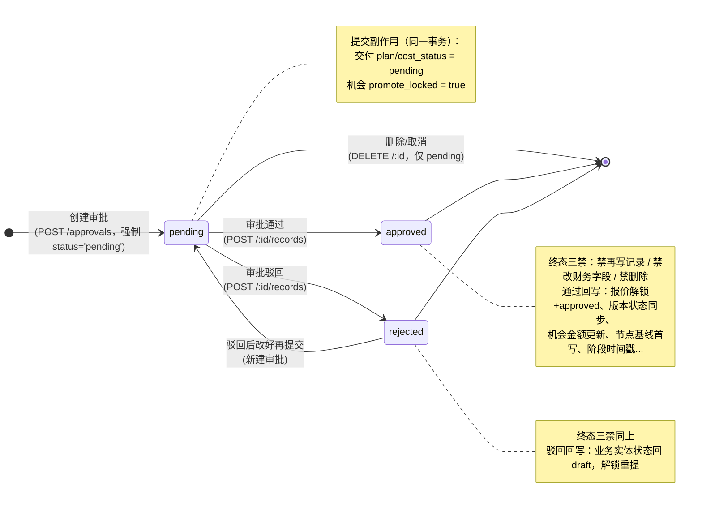
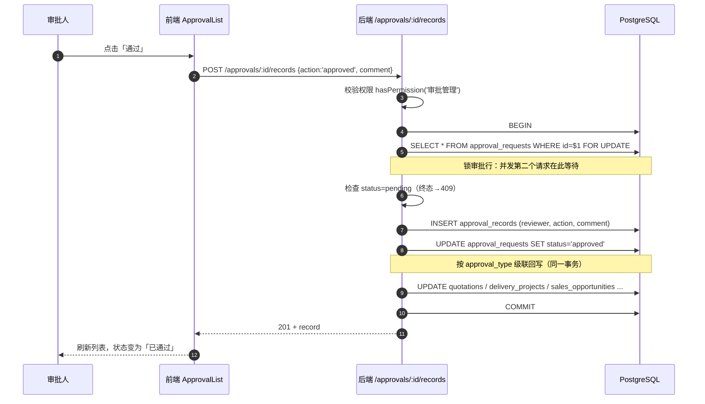

# 09 审批状态机详解

> **本章学习目标**
> 1. 理解 4 种审批类型各自的业务含义与级联目标；
> 2. 逐行读懂"创建审批"与"审批处理"两个最核心的端点；
> 3. 理解**事务 + 行锁**如何防并发双审批；
> 4. 理解"审批 → 回写"的状态机纪律（为什么不能用通用 PUT 改状态）。

---

## 9.1 为什么要一个审批系统

报价/交付都涉及钱和承诺，不能一个人说了算。审批系统提供：
- **留痕**：谁提交、谁审批、批了什么，全部记录（`approval_requests` + `approval_records`）；
- **锁定**：审批提交后锁住业务（防边审批边改）；
- **状态机**：审批请求**创建即 `pending`**（`draft` 仅是 DB 默认值、代码层不可达——创建接口强制 `status='pending'`），终态 `approved/rejected` 只能经审批处理流转；而业务实体状态（报价 `quotations.status`、版本 `review_status`、交付 `plan_status/cost_status`）是完整的 `draft → pending → approved/rejected`。

**四种审批类型**：

| approval_type | 审批什么 | 通过时回写什么 |
|---|---|---|
| `quotation` | 报价 | 报价 `status=approved` + 解锁 + 版本状态同步 + 机会金额更新 |
| `plan` | 交付实施计划 | `plan_status=approved` + `plan_approval` JSONB + **节点基线首写** |
| `cost` | 交付成本对比 | `cost_status=approved` + `cost_approval` JSONB |
| `promote` | 晋升/转机会 | 解锁 `promote_locked` + 机会 stage 推进 + 阶段时间戳 |

**两个入口、职责分明**：`POST /approvals`（创建）把状态写成 `pending`；`POST /:id/records`（通过/驳回）是**终态（approved/rejected）唯一流转点**。通用 PUT 被 `excludeOnUpdate` 挡掉 `status`、`beforeUpdate` 拒绝终态改动，DELETE 只对 pending 开放。

### 9.1.1 审批状态迁移图

```
创建审批（POST /approvals，服务端强制 status='pending'）
    │
    ▼
 pending ──通过──▶ approved （终态）
    │
    ├──驳回──▶ rejected （终态）──改后重新提交（新建审批）──▶ pending
    │
    └──删除/取消（DELETE /:id）──▶ 审批行删除；业务实体状态回 draft
```



> **读图要点**：
> - **审批请求本身没有 draft 态**——创建即 `pending`（`draft` 只是 DB 默认值，代码层恒覆盖为 pending）。`draft → pending` 是**业务实体**（报价/版本/交付 plan·cost）的状态路径，不是审批请求的。
> - `approved/rejected` 只能经 `POST /:id/records` 流转（创建接口只写 pending）；三处守卫同口径 `isFinalApprovalStatus`（禁再写记录/禁改财务字段/禁删除）。
> - 删除只对 pending 审批开放；删除 = 取消提交，**回滚创建时对业务实体设置的级联副作用**（plan/cost_status、promote_locked、报价/版本状态回 draft）。

## 9.2 状态机与常量（approvals.ts 顶部）

```ts
export const APPROVAL_ACTIONS = ['approved', 'rejected'] as const;
export const FINAL_APPROVAL_STATUS = ['approved', 'rejected'] as const;
export const APPROVAL_TYPES = ['quotation', 'plan', 'cost', 'promote'] as const;
export const APPROVAL_INSERT_EXCLUDE = ['id', 'created_at', 'updated_at', 'status', 'submit_time', 'submitter'];

/** 审批类型 → 同实体去重列（防同实体同类型重复 pending；plan/cost 均按 delivery_id） */
export function approvalTypeToDupColumn(type: string): string {
  return type === 'quotation' ? 'quotation_id'
    : type === 'promote' ? 'opportunity_id'
    : 'delivery_id';
}

/** 审批类型 → 父实体表名（查重 FOR UPDATE 锁父行用） */
export function approvalTypeToParentTable(type: string): string {
  return type === 'quotation' ? 'quotations'
    : type === 'promote' ? 'sales_opportunities'
    : 'delivery_projects';
}

/** 是否终审状态（approved/rejected 不可再写记录、不可改财务字段、不可删除——三条守卫同口径） */
export function isFinalApprovalStatus(status: string | undefined): boolean {
  return !!status && (FINAL_APPROVAL_STATUS as readonly string[]).includes(status);
}
```

**approvalTypeToDupColumn** 的理解：一个"实体"（报价/机会/交付）同一类型只能有一个待审批（pending）。去重列就是"哪个字段唯一标识这个实体"：
- quotation → `quotation_id`
- promote → `opportunity_id`
- plan/cost → `delivery_id`

## 9.3 创建审批：POST /（含去重与级联锁定）

```ts
router.post('/', async (req, res, next) => {
  try {
    let body = objKeysToSnake({ ...req.body });
    const { approval_type, opportunity_id, delivery_id } = body;

    // C2 审计修复：approval_type 枚举白名单（DB 列是 PG 枚举，非法值直插会抛 500）
    if (!(APPROVAL_TYPES as readonly string[]).includes(approval_type)) {
      throw new AppError(400, '无效审批类型，允许值：quotation, plan, cost, promote');
    }

    const record = await withTransaction(async (client) => {
      // ── ① 同实体同类型去重：先锁父行再查（防并发重复提交） ──
      const dupCol = approvalTypeToDupColumn(approval_type);
      const dupVal = (body as Record<string, any>)[dupCol];
      if (dupVal) {
        const parentTable = approvalTypeToParentTable(approval_type);
        await client.query(`SELECT 1 FROM ${parentTable} WHERE id = $1 FOR UPDATE`, [dupVal]);
        const dup = (await client.query(
          `SELECT 1 FROM approval_requests WHERE approval_type = $1 AND ${dupCol} = $2 AND status = 'pending'`,
          [approval_type, dupVal])).rows[0];
        if (dup) throw new AppError(409, '该...已有待审批请求，请勿重复提交');
      }

      // ── ② 级联置 pending / 锁定 ──
      if (approval_type === 'plan' && delivery_id)
        await client.query('UPDATE delivery_projects SET plan_status = $1 WHERE id = $2', ['pending', delivery_id]);
      if (approval_type === 'cost' && delivery_id)
        await client.query('UPDATE delivery_projects SET cost_status = $1 WHERE id = $2', ['pending', delivery_id]);
      if (approval_type === 'promote' && opportunity_id)
        await client.query('UPDATE sales_opportunities SET promote_locked = true WHERE id = $1', [opportunity_id]);

      // promote 审批自动回填财务字段（从报价/版本取数，见 applyPromoteDefaults）...

      // ── ③ 强制 status='pending'，submitter 由服务端派生 ──
      const insertCols = fields.filter(f => !APPROVAL_INSERT_EXCLUDE.includes(f) && body[f] !== undefined);
      if (insertCols.length === 0) throw new AppError(400, '没有要插入的字段');
      body.submitter = req.user?.display_name || '审批申请人';   // 防伪造提交人
      insertCols.push('status', 'submitter');
      body.status = 'pending';
      return (await client.query(`INSERT INTO approval_requests (...) VALUES (...) RETURNING *`,
        insertCols.map(f => body[f]))).rows[0];
    });

    logAudit(req, '提交审批', 'approval', '...');
    res.status(201).json(record);
  } catch (err) { ... }
});
```

**三个难点逐一展开**：

### 9.3.1 并发去重：为什么先 `FOR UPDATE` 锁父行？

如果两个用户几乎同时提交同一机会的 promote 审批：
- 两个请求都查 `SELECT ... WHERE status='pending'` → **都查不到**（因为都还没插入）；
- 两个都继续插入 → 出现**两条 pending**。

解法：先对父实体行 `SELECT ... FOR UPDATE`（行级锁）：
- 请求 A 先拿到锁，插入 pending，提交事务，释放锁；
- 请求 B 等在锁上，等 A 提交后**重新查** → 这次必见 A 的 pending → 409。

**"判断与写入必须在同一事务 + 加行锁"** 是并发控制的金科玉律（家族缺陷 F03）。如果判断在事务外，锁就毫无意义。

### 9.3.2 级联置 pending / 锁定

提交审批的**副作用**：
- plan 审批提交 → 交付的 `plan_status=pending`（计划进入"待审批"）；
- cost 审批提交 → `cost_status=pending`；
- promote 审批提交 → 机会 `promote_locked=true`（**锁定机会**，防止审批期间被改）。

这些副作用和"插入审批行"在**同一个事务**里，要么全成、要么全败。

### 9.3.3 submitter 服务端派生

`body.submitter = req.user?.display_name`——**不信任客户端提交的 submitter**。否则前端能伪造"谁提交的"。服务端从登录用户派生（BE-7 修复）。

## 9.4 审批处理：POST /:id/records（状态机的心脏）

```ts
router.post('/:id/records', async (req, res, next) => {
  try {
    const { id } = req.params;
    const { action, comment } = req.body;
    if (!isValidApprovalAction(action)) throw new AppError(400, `无效操作: ${action}`);

    // 权限检查前置：先鉴权再读数据（防未授权探测审批详情）
    if (!hasPermission(req.user?.permissions, '审批管理', '全部查看权限'))
      throw new AppError(403, '无审批权限');

    // reviewer 强制取自登录用户（防伪造审批人）
    const approver = (await query('SELECT display_name, email FROM users WHERE id = $1', [req.user?.userId])).rows[0];
    const reviewer = approver?.display_name || req.user?.email || '未知用户';

    const { record, approvalType } = await withTransaction(async (client) => {
      // ── ① 锁审批行 + 终审检查（同一事务）──
      const ar = (await client.query('SELECT * FROM approval_requests WHERE id = $1 FOR UPDATE', [id])).rows[0];
      if (!ar) throw new AppError(404, '审批请求未找到');
      if (isFinalApprovalStatus(ar.status)) throw new AppError(409, '该审批已处理完毕，不可重复审批');

      // ── ② 写审批记录 + 改审批状态 ──
      const record = (await client.query(
        'INSERT INTO approval_records (approval_request_id, reviewer, action, comment) VALUES ($1,$2,$3,$4) RETURNING *',
        [id, reviewer, action, comment || ''])).rows[0];
      const newStatus = action === 'approved' ? 'approved' : 'rejected';
      await client.query('UPDATE approval_requests SET status = $1 WHERE id = $2', [newStatus, id]);

      // ── ③ 级联回写（按审批类型）──
      const appraisal = buildAppraisalJson(reviewer, action, comment || '', new Date().toISOString());

      if (ar.approval_type === 'promote' && ar.opportunity_id) {
        await client.query('UPDATE sales_opportunities SET promote_locked = false WHERE id = $1', [ar.opportunity_id]);
        if (newStatus === 'approved')
          await client.query("UPDATE sales_opportunities SET stage = '机会', lead_at = COALESCE(lead_at, now()), opportunity_at = COALESCE(opportunity_at, now()) WHERE id = $1", [ar.opportunity_id]);
      }
      if (ar.approval_type === 'plan' && ar.delivery_id) {
        await client.query('UPDATE delivery_projects SET plan_status = $1, plan_approval = $2 WHERE id = $3', [newStatus, appraisal, ar.delivery_id]);
        if (newStatus === 'approved')
          await client.query('UPDATE delivery_nodes SET baseline_planned_end_date = planned_end_date WHERE delivery_project_id = $1 AND baseline_planned_end_date IS NULL', [ar.delivery_id]);
      }
      if (ar.approval_type === 'cost' && ar.delivery_id) {
        await client.query('UPDATE delivery_projects SET cost_status = $1, cost_approval = $2 WHERE id = $3', [newStatus, appraisal, ar.delivery_id]);
      }
      if (ar.approval_type === 'quotation' && ar.quotation_id) {
        await client.query('UPDATE quotations SET locked = false, status = $1 WHERE id = $2', [newStatus, ar.quotation_id]);
        if (ar.version_no) {
          const qi = (await client.query('SELECT project_id FROM quotations WHERE id = $1', [ar.quotation_id])).rows[0];
          if (qi?.project_id)
            await client.query('UPDATE project_versions SET review_status = $1 WHERE project_id = $2 AND version_no = $3', [newStatus, qi.project_id, ar.version_no]);
        }
        if (newStatus === 'approved') {
          const qt = (await client.query('SELECT opportunity_id, amount FROM quotations WHERE id = $1', [ar.quotation_id])).rows[0];
          if (qt?.opportunity_id && qt?.amount > 0)
            await client.query('UPDATE sales_opportunities SET amount = $1 WHERE id = $2', [round2(parseFloat(qt.amount) || 0), qt.opportunity_id]);
        }
      }
      return { record, approvalType: ar.approval_type };
    });

    logAudit(req, action === 'approved' ? '审批通过' : '审批驳回', 'approval', '...');
    res.status(201).json(record);
  } catch (err) { next(err); }
});
```

### 9.4.1 审批处理时序图（POST /:id/records）



> **时序要点**：`FOR UPDATE` 在事务内锁行 → 终审检查与写入同事务 → 级联回写全部在一个事务里。任何一步失败整体回滚，绝无"状态改了但回写没改"的半吊子数据。第 4 步的锁正是防**并发双击**（第二个请求等到第一个提交后重查，发现终态 → 409）。

### 9.4.2 为什么 `FOR UPDATE` 锁审批行？

防**并发双击双审批**（A7 修复）：两个请求同时到，若不在事务里锁行，两边都读 `status=pending`，两边都写 `approved` → 状态被翻转两次、两条审批记录。锁行后第二个请求等第一个提交，重查发现已是终态 → 409。

### 9.4.3 级联回写——按类型展开的"状态机"

**quotation 通过**（最复杂的回写）：
1. 报价解锁 + `status=approved`；
2. 同步 `project_versions.review_status=approved`（版本状态跟报价走）；
3. 机会金额更新为 `round2(报价金额)`——报价审批通过后，机会金额自动对齐报价（这是 4.7 状态机表里"报价审批通过自动更新金额"的来源）。

**plan 通过**：
1. `plan_status=approved` + `plan_approval` JSONB（审批结果留档）；
2. **节点基线首写**：`baseline_planned_end_date = planned_end_date`，**只写给 NULL 的节点**（`AND baseline_planned_end_date IS NULL`）——已经审批过的基线**不可变**，这是延期判定可信的前提。

**promote 通过**：
1. 解锁 `promote_locked=false`；
2. 机会 stage 推进到"机会" + 写 `lead_at`/`opportunity_at`（`COALESCE` 首写，与 opportunities.ts 的阶段时间戳规则一致——财年归集需要它）。

### 9.4.4 所有写都在一个事务里

插入记录 + 改状态 + 级联回写，**要么全成要么全败**。如果中途失败（如某个 UPDATE 报错），整个事务回滚，不会出现"状态改了但回写没改"的半吊子数据。

## 9.5 删除审批：回滚级联（F5 修复）

删除 **pending** 审批时，要把"创建时设置的副作用"**回滚**掉，否则会留下永久卡死的状态：

```ts
// 回滚级联（仅当关联记录仍处于该审批设置的 pending/locked 状态时复位，避免覆盖后续新审批）
if (row.approval_type === 'plan' && row.delivery_id)
  await client.query(`UPDATE delivery_projects SET plan_status='draft' WHERE id=$1 AND plan_status='pending'`, [row.delivery_id]);
if (row.approval_type === 'promote' && row.opportunity_id)
  await client.query(`UPDATE sales_opportunities SET promote_locked=false WHERE id=$1 AND promote_locked=true`, [row.opportunity_id]);
// quotation 同理：回滚报价与版本的 pending → draft
```

两个细节：
- **已终审的审批不可删除**（`isFinalApprovalStatus` → 409）——终审记录是历史证据；
- **复位用条件更新**（`AND plan_status='pending'`）——如果期间又提交了新的审批（状态已是 pending 以外），不覆盖它。

## 9.6 三条"同一口径"的守卫

`isFinalApprovalStatus` 被三处共用，锁死"终态不可再动"：
1. `beforeUpdate`：终审审批**禁改财务字段**（409）；
2. `/:id/records`：终审**禁再写审批记录**（409）；
3. `DELETE /:id`：终审**禁删除**（409）。

三处同一判据 → 单一来源 → 不会出现"某个入口漏了"。

## 9.7 测试与静态断言

- `tests/approvals.test.ts`：直测 `isValidApprovalAction`、`isFinalApprovalStatus`、`approvalTypeToDupColumn` 等纯函数；
- `tests/route-guards.test.ts`：`computeInsertCols` 剥除 `status` 的契约（A2/A3）、`selectApprovalPerms` 映射；
- `tests/audit-fixes.test.ts`：`APPROVAL_INSERT_EXCLUDE` 命名常量断言——**锁命名常量本身，而不是锁"恰好是这个形状的代码"**（F12 教训：source 断言别依赖偶然代码形态）。

## 9.8 本章小结

- 审批 = 状态机（draft→pending→approved/rejected）+ 事务 + 行锁 + 级联回写。
- 创建时：去重（FOR UPDATE 锁父行）、级联置 pending/locked、submitter 服务端派生。
- 处理时：锁审批行 + 终审检查（同事务）、写记录 + 改状态 + 按类型回写。
- 删除时：只删 pending、回滚级联（条件更新防覆盖）。
- 铁律：**approved/rejected 终态只能经 POST /:id/records 流转**；创建时 status 由服务端强制 `pending`；通用 PUT 禁改 status（`excludeOnUpdate`）、终审禁删除、删除只对 pending 开放并回滚级联。

**本章练习**：
1. 画一张"quotation 审批通过"的状态迁移图，标出涉及的所有表和字段；
2. 用 `npm test` 跑 `approvals` 相关测试，读懂每一条在锁什么契约；
3. 思考：如果并发两个 `POST /:id/records` 都通过了检查，会怎样？为什么不会发生？（答案在 9.4.1）

> 下一章：[10 交付与销售分析](10-交付与销售分析.md) →
